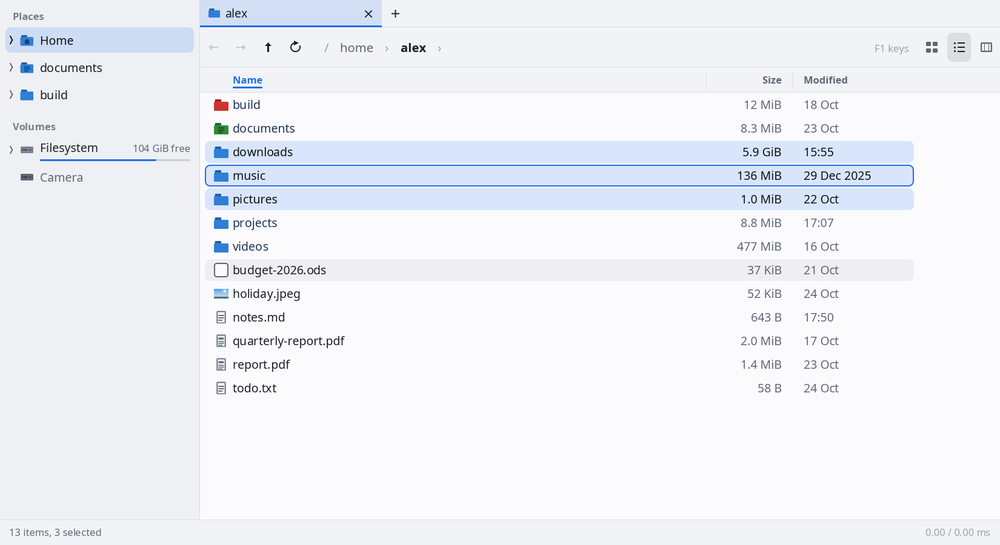
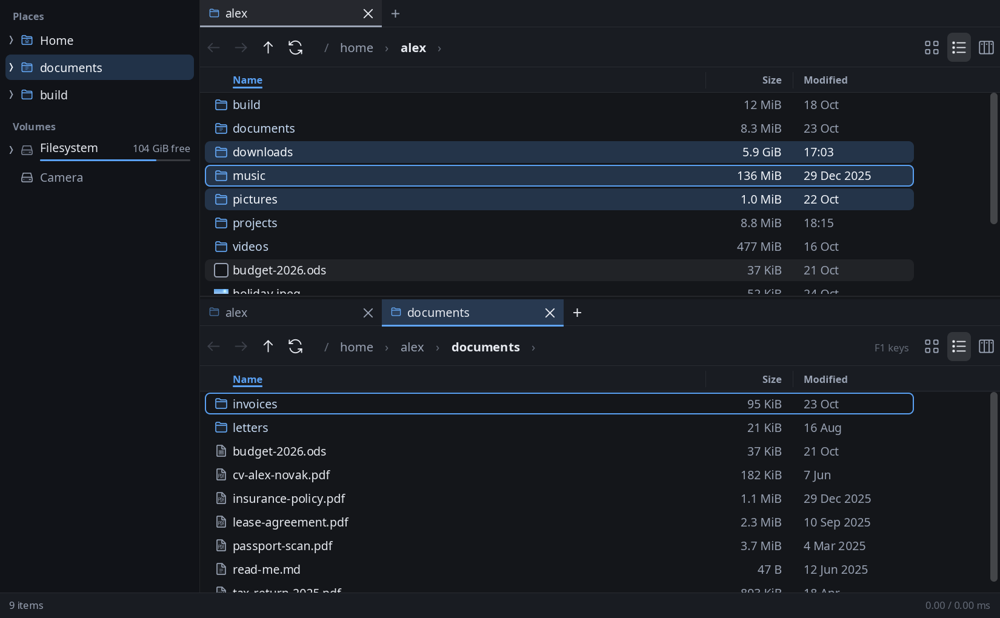
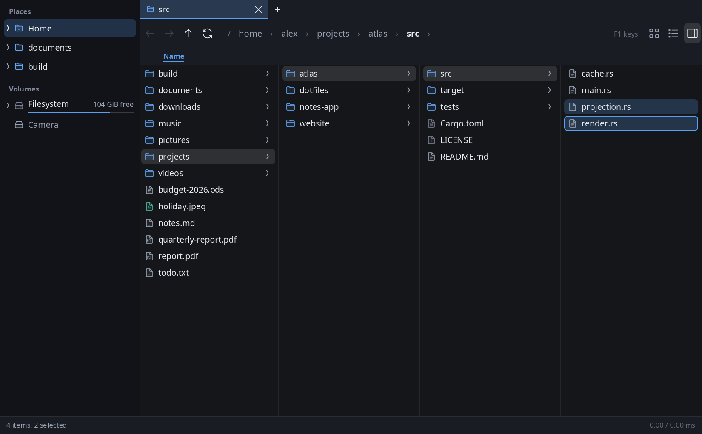
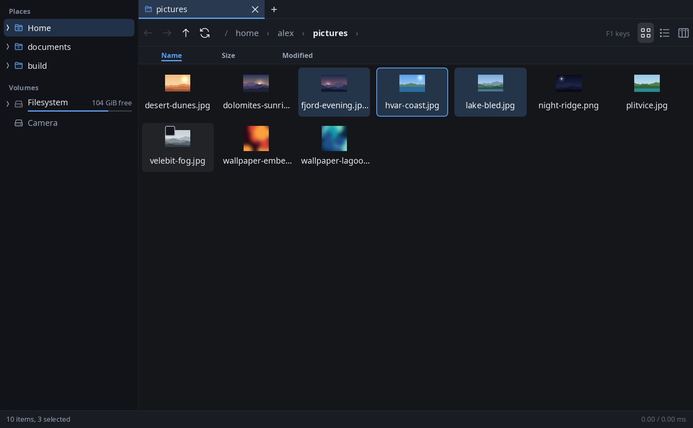
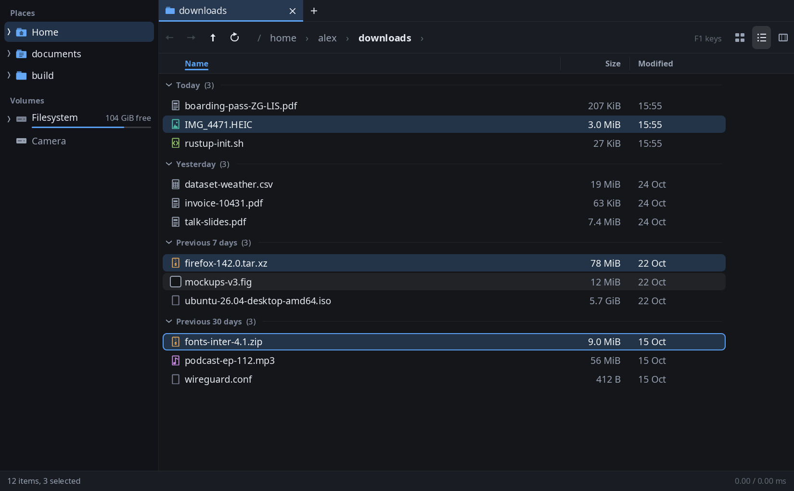
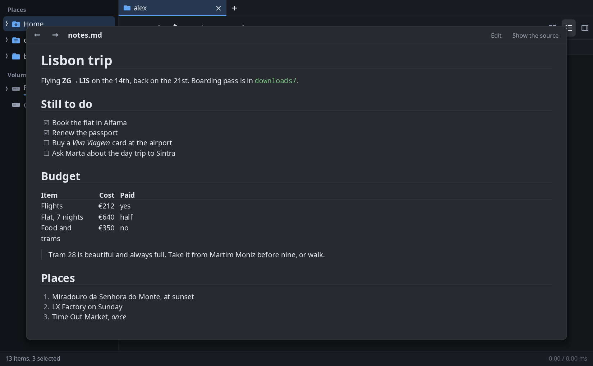
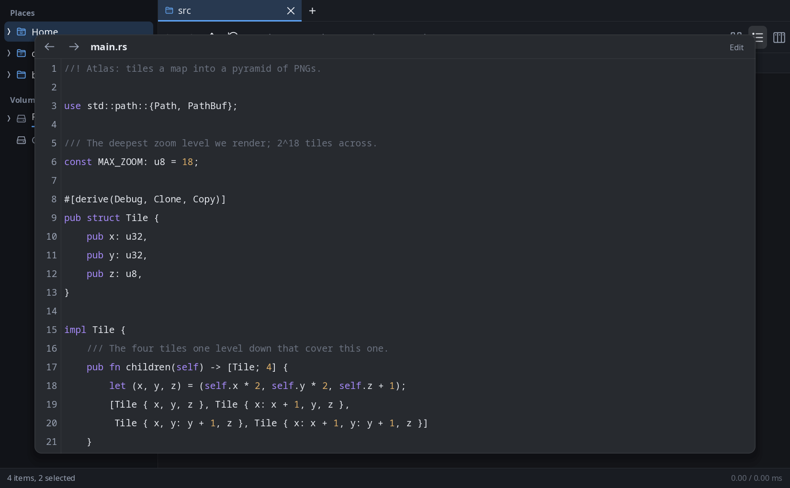
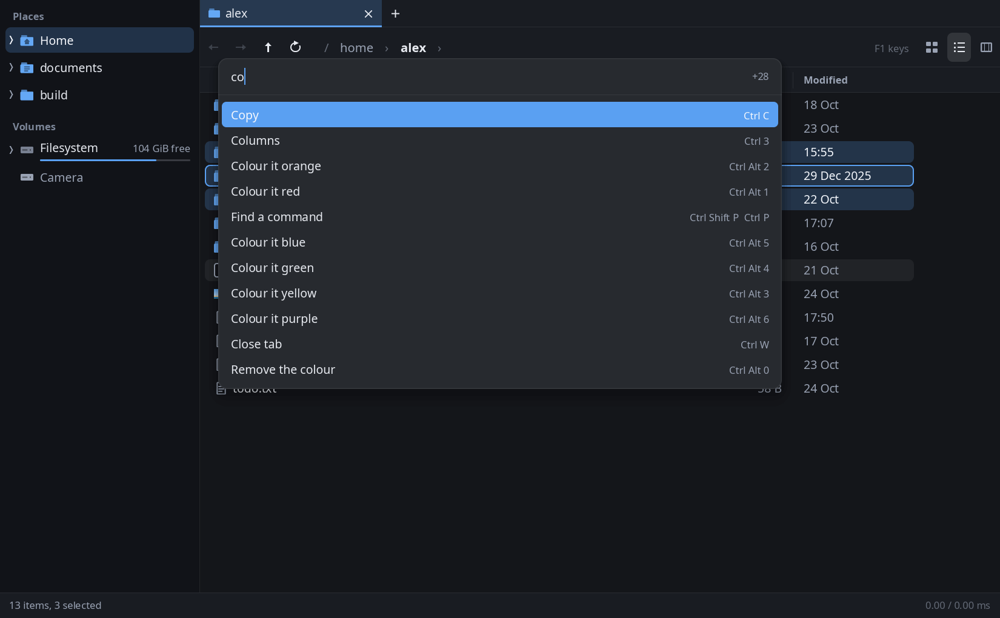
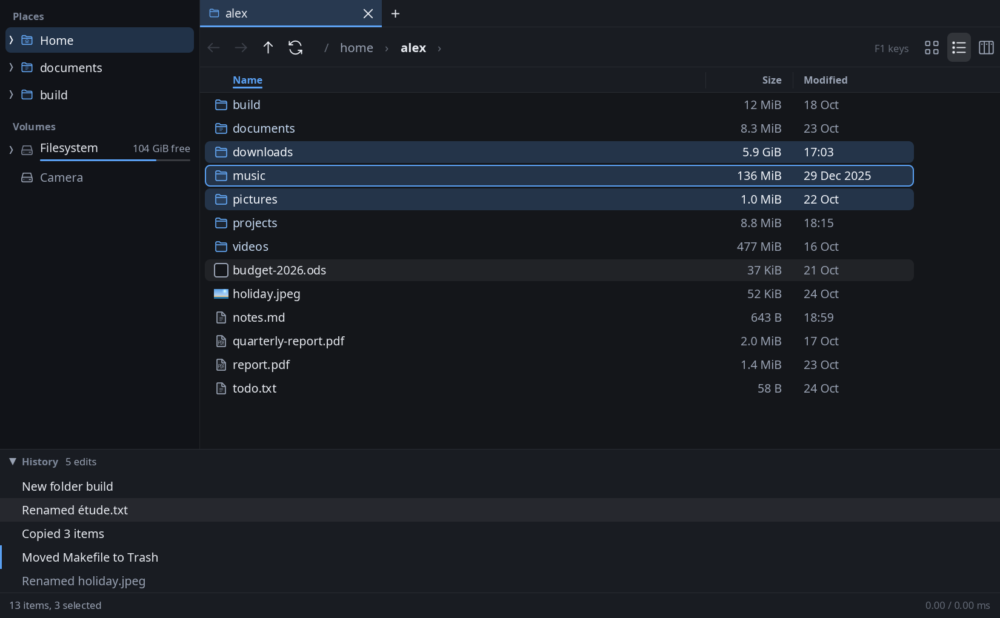

# Skerry

A fast, keyboard-and-mouse file manager for Linux, written in Rust. It runs on
Wayland and X11 on any distribution and does not depend on GTK, Qt or GLib.

This is an alpha. Keep backups of important files.

<picture>
  <source media="(prefers-color-scheme: dark)" srcset="docs/screenshots/hero-dark.png">
  
</picture>

## What it does

- Details, grid and column views, which stay smooth with hundreds of thousands of files in one folder
- Tabs and split panes, and files can be dragged between them
- Copy, cut, paste, duplicate, rename, new folder and Move to Trash. Every one of them can be undone, and the undo history is visible
- Copies show a real ETA, and they can be paused and resumed
- A sidebar with places, pinned folders (shared with Nautilus and other GTK file managers) and drives, including drives that are not mounted yet
- Search under a folder or across every local disk, with an optional index for very large trees
- Quick look (`Space`) for pictures, GIFs, PDFs, Markdown, source code with highlighting, and archive contents, with a small built-in text editor
- Zip and tar archives open in place and unpack in one step
- Folder colours, grouping by date, size or kind, and per-folder view settings
- A command palette and context menu. Every action can be done with the keyboard alone or the mouse alone
- Keybindings and settings live in one plain-text file: `~/.config/skerry/config`
- Restores your tabs and layout after a restart, including after a crash
- Early screen-reader support (AT-SPI), and input methods on Wayland

## Screenshots

| Tabs and split panes | Column view |
| --- | --- |
|  |  |
| **Grid with thumbnails** | **Grouped by date** |
|  |  |
| **Quick look at Markdown** | **Quick look at source code** |
|  |  |
| **Command palette** | **Undo history** |
|  |  |

## Building

You need Rust 1.90 or newer and the development package for `libxkbcommon`.

```sh
make                    # builds everything in release mode
cargo run --release -- ~/Downloads    # or run it straight from the checkout
```

Press `F1` in the window to see every keyboard shortcut.

## Installing

```sh
make                                 # first, as yourself: installing builds nothing
sudo make install                    # into /usr/local
make install PREFIX=$HOME/.local     # or just for your account
make uninstall                       # with the same PREFIX to remove it
```

This installs four binaries, a desktop entry and an icon. It does not change your
default file manager. To make Skerry the default, use *Open folders with Skerry*
in the settings panel (`Ctrl+,`). `make install` builds nothing and stops if
`make` has not run, so `sudo` never reaches a dependency's build script.

Prebuilt tarballs for x86-64 and aarch64 are attached to tagged releases and need
no Rust. They require glibc 2.39 or newer, so Debian 12 and Ubuntu 22.04 must
build from source instead. Each tarball is attested by the release workflow that
built it; check one with the [GitHub CLI](https://cli.github.com) before
extracting it:

```sh
gh attestation verify skerry-VERSION-ARCH-linux.tar.gz --repo EmilPopovic/skerry \
  --signer-workflow EmilPopovic/skerry/.github/workflows/release.yml
```

See [packaging/README.binary.md](packaging/README.binary.md).

To run Skerry you need a Wayland or X11 session and Vulkan or OpenGL. Software
rendering works. PDF previews use a PDF renderer on your `PATH` if one is installed.

## What this alpha does not do

- No new-file, templates, symlink creation or batch rename
- No 7z or rar, and no video, audio or hex previews
- Properties can change basic permissions only. Owners and ACLs cannot be edited
- No settings panel for keybindings. Edit the config file instead
- English only
- No input method or touchpad gestures on X11
- No encrypted (LUKS) volumes
- Files copied to the clipboard cannot be pasted into sandboxed Flatpak apps

To report a security issue, see [SECURITY.md](SECURITY.md).

## Licence

Apache-2.0. See [LICENSE](LICENSE) and [NOTICE](NOTICE).
